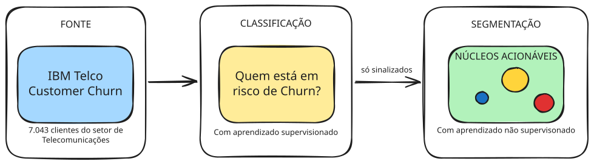

# Telecom Churn Pipeline

Pipeline operacional para predição de churn e segmentação de clientes em risco em telecomunicações.

## Overview
Projeto Integrador (UTFPR, Ciência de Dados) que implementa um **pipeline recorrente**: a cada ciclo a carteira entra, um classificador sinaliza quem está em risco e o **K-Means** agrupa **somente esses sinalizados** em **núcleos acionáveis** (volume, fatura e receita exposta). A operação desenha a ação por núcleo, em vez de tratar toda a lista do mesmo jeito.

O laboratório são os notebooks (Optuna, SHAP, artigo SBC). A via operacional é a **API FastAPI** no Docker Compose: extração pela API do Kaggle, treino registrado no MLflow, promoção a *champion* e `score` em lote. Sem MLflow no ar e sem *champion*, o ciclo não fecha. A base é a pública **IBM Telco Customer Churn** (7.043 clientes). Na corrida de referência do laboratório, o **XGBoost** obteve AUC-ROC 0,847, acurácia 80,6% e precisão 66,4%; 1.556 clientes foram sinalizados e agrupados com **K = 3**, expondo R$ 123,4 mil/mês.



## Tech Stack
* **Linguagem:** Python 3.12
* **Gerenciamento de Pacotes:** uv
* **Data Tools:** pandas, NumPy, PyArrow (Parquet)
* **Machine Learning:** scikit-learn, XGBoost, LightGBM, Random Forest
* **Clustering:** K-Means, DBSCAN, PCA
* **Otimização:** Optuna
* **Interpretabilidade:** SHAP
* **Estatística:** SciPy (Mann-Whitney, Spearman)
* **Visualização:** Matplotlib, Seaborn
* **MLOps:** FastAPI, MLflow (tracking + Model Registry), MinIO (S3), PostgreSQL, Docker Compose, pytest, GitHub Actions
* **Documentação:** LaTeX (formato SBC)

## Estrutura do Projeto
```text
.
├── apresentacao/            # Slides finais (PDF)
├── article/                 # Artigo científico (SBC)
├── estudo_piloto/           # Primeiro recorte (1.000 clientes, 2 variáveis)
├── data/                    # raw / interm / processed (não versionado)
├── models/                  # pkl + production.json (nascem no train)
├── notebooks/               # Laboratório (ETL → EDA → features → churn → clustering → relatório)
├── src/projeto_integrador/  # CLI + API (extract Kaggle, train, promote, score)
├── tests/                   # Schema, consolidação, registry e API
├── docker-compose.yml       # API + MLflow + Postgres + MinIO
├── docker/mlflow.Dockerfile
├── Dockerfile
└── pyproject.toml           # Dependências (uv)
```

## Processo
* **Extract:** download da IBM Telco pela **API do Kaggle** (`blastchar/telco-customer-churn`), limpeza e persistência em Parquet.
* **EDA:** contrato mensal como principal discriminante (42,7% vs 2,8% no bienal); Mann-Whitney e Spearman.
* **Features:** 21 colunas → 47 atributos (tempo, financeiro, serviços, risco/interação); split 80/20 estratificado; scaler só no treino.
* **Classificação:** RF × XGBoost × LightGBM, Optuna, limiar calibrado (0,795); SHAP no laboratório.
* **Segmentação:** K-Means só nos sinalizados (K = 3); DBSCAN como comparativo.
* **Núcleos:** volume, fatura média e receita exposta por grupo — saída de cada corrida do `score`. Campanha no notebook é exemplo; a ação fica com a operação.

## Pipeline operacional
```text
Kaggle → POST /extract → /validate → /train (candidate) → /promote (champion) → /score → núcleos
```

O `train` não sobe sem `MLFLOW_TRACKING_URI`. O `score` não pontua sem `production.json` **e** sem o alias **champion**. Optuna e SHAP ficam nos notebooks; o `train` refaz a receita já escolhida.

```powershell
Copy-Item .env.example .env
# Preencha KAGGLE_USERNAME e KAGGLE_KEY (https://www.kaggle.com/settings)
docker compose up -d
```

```bash
curl -X POST http://localhost:8000/extract
curl -X POST http://localhost:8000/validate
curl -X POST http://localhost:8000/train
curl -X POST http://localhost:8000/promote
curl -X POST http://localhost:8000/score
```

* API: http://localhost:8000/docs
* MLflow: http://localhost:5010
* MinIO: http://localhost:9001 (`user` / `password`)

O CLI (`uv run projeto-integrador …`) chama as mesmas funções, também exigindo MLflow e o token do Kaggle no `extract`.

## Apresentação
* Vídeo: https://youtu.be/elyn0_sRDXU
* Slides: [apresentacao/](apresentacao/)
